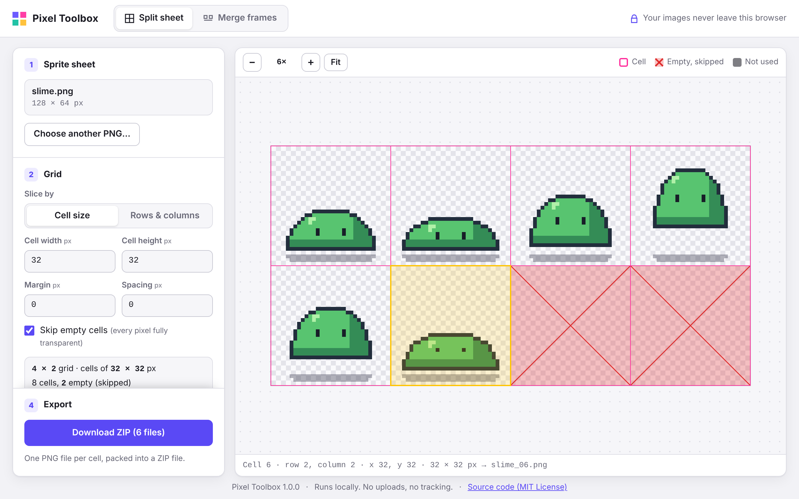

# Pixel Toolbox

A small, free web tool for pixel artists and 2D game developers.
This first version does one job: **splitting and merging sprite sheets**.

It is a plain static web page (HTML, CSS and JavaScript). There is no server,
no account and no upload: your images are processed inside your own browser.
It works on GitHub Pages, and it works offline from a downloaded copy.



## What it does

### Split a sprite sheet into frames

1. Drop a PNG sprite sheet on the page (or click **Choose a PNG file**).
2. Describe the grid, either **by cell size** (e.g. 32 × 32 px) or **by rows & columns**.
   Set the **margin** (empty border around the whole sheet) and the **spacing**
   (gap between cells) if your sheet has them.
3. Check the preview: the grid is drawn over the image, parts outside the grid are
   dimmed, and empty cells are crossed out. Point at a cell to see its position and
   the file name it will get.
4. Leave **Skip empty cells** on to leave out cells whose pixels are all fully transparent.
5. Choose a file name **prefix**, the **start number** and how many **digits** to pad to,
   for example `walk_` + `1` + `2` → `walk_01.png`, `walk_02.png`, …
6. Click **Download ZIP**. You get one PNG per cell, numbered left to right, top to bottom.

### Merge frames into a sprite sheet

1. Switch to **Merge frames** and drop several PNG files at once.
2. They are sorted by file name in natural order (`walk_2.png` comes before `walk_10.png`).
   Drag a frame to move it, or use **Sort by name** to go back to name order.
   (Keyboard: focus a frame, then <kbd>Alt</kbd> + arrow keys to move it, <kbd>Delete</kbd> to remove it.)
3. Set **frames per row**, **spacing** and **margin**.
4. Frames may have different sizes. Every cell takes the size of the largest frame,
   and smaller frames are either **centered** or placed **on the bottom** edge of their
   cell (centered horizontally), which keeps a character's feet on the same line.
5. Click **Download PNG** for the sheet and **Download JSON** for the frame data.

Pixels are always copied 1:1. There is no smoothing, no resampling and no interpolation,
and the zoomed preview uses nearest-neighbour scaling so pixels stay sharp.

### The JSON file

The JSON file lists every frame's name, position and size in the sheet. It follows the
widely used “JSON Array” texture-atlas layout, so many engines and frameworks can read it
directly. Example (2 frames per row, 1 px margin, 2 px spacing, bottom-aligned):

```json
{
  "frames": [
    {
      "filename": "walk_01.png",
      "frame": { "x": 1, "y": 1, "w": 32, "h": 32 },
      "rotated": false,
      "trimmed": false,
      "spriteSourceSize": { "x": 0, "y": 0, "w": 32, "h": 32 },
      "sourceSize": { "w": 32, "h": 32 },
      "cell": { "x": 1, "y": 1, "w": 32, "h": 32 }
    },
    {
      "filename": "walk_02.png",
      "frame": { "x": 37, "y": 3, "w": 28, "h": 30 },
      "rotated": false,
      "trimmed": true,
      "spriteSourceSize": { "x": 2, "y": 2, "w": 28, "h": 30 },
      "sourceSize": { "w": 32, "h": 32 },
      "cell": { "x": 35, "y": 1, "w": 32, "h": 32 }
    }
  ],
  "meta": {
    "app": "Pixel Toolbox",
    "version": "1.0.0",
    "image": "walk.png",
    "format": "RGBA8888",
    "size": { "w": 68, "h": 68 },
    "scale": "1",
    "grid": {
      "columns": 2,
      "rows": 2,
      "cell": { "w": 32, "h": 32 },
      "margin": 1,
      "spacing": 2,
      "align": "bottom"
    }
  }
}
```

| Field | Meaning |
| --- | --- |
| `frame` | Where the frame's own pixels are in the sheet (x, y, width, height). |
| `cell` | The frame's whole cell in the sheet. All cells have the same size. |
| `spriteSourceSize` | Where the frame's pixels sit inside its cell. |
| `sourceSize` | The cell size. |
| `trimmed` | `true` when the frame is smaller than its cell. |
| `meta.grid` | Columns, rows, cell size, margin, spacing and alignment used. |

## Privacy

**Your images never leave your browser.**

- Files are opened with the browser's File API, decoded and processed in memory, and
  handed back to you as downloads. Nothing is sent to any server, including the one
  that hosts the page.
- The page loads no third-party scripts, fonts, analytics or trackers. Every file it
  uses is in this repository.
- The page sets a Content Security Policy with `connect-src 'none'`, which tells the
  browser to block the page's scripts from making network requests at all.

You can check this yourself: open the page, open your browser's developer tools, and
watch the Network tab while you split or merge images. Or use the tool with your
network switched off.

## Open it on your computer

No installation and no build step are needed.

1. On GitHub, click **Code → Download ZIP** (or run `git clone https://github.com/YunaWorks/pixel-toolbox.git`).
2. Unzip it.
3. Double-click **`index.html`**. It opens in your browser and works offline.

If you prefer serving it locally, any static file server works, for example
`python3 -m http.server` in the project folder, then open <http://localhost:8000>.

### Put it on GitHub Pages

In your copy of the repository on GitHub: **Settings → Pages → Build and deployment**,
choose **Deploy from a branch**, select the `main` branch and the `/ (root)` folder,
then **Save**. The tool will be available at `https://<your-name>.github.io/pixel-toolbox/`.

### Browser support

A current version of Chrome, Edge, Firefox or Safari (desktop or mobile). The tool uses the
browser's built-in compression streams, which are available in Chrome and Edge 80+,
Firefox 113+ and Safari 16.4+.

## Details and limits

- Input files must be PNG. All PNG types are read (greyscale, RGB, palette, with or without
  transparency, 1 to 16 bits per channel, interlaced). 16-bit images are reduced to 8 bits
  per channel. The colour values stored in the file are kept exactly, including those of
  semi-transparent pixels; no colour-profile conversion is applied.
- Output files are 8-bit RGBA PNG.
- A cell is “empty” only if every pixel in it has alpha 0.
- Grid by cell size: every whole cell that fits after the margin is used. Grid by rows &
  columns: the area inside the margin is divided evenly; if it doesn't divide evenly, the
  leftover pixels at the right/bottom are not used, and the tool tells you how many.
- When a frame can't be centered exactly in its cell, the extra pixel goes to the right
  (or bottom).
- Images can be up to 8192 × 8192 px, and a sheet can be split into up to 16,384 cells.

## Development

There is nothing to install. The code is plain JavaScript that runs directly in the
browser, and the same core files are loaded by Node.js for the tests.

```
index.html        the page
css/style.css     styles
js/app.js         user interface
js/split.js       splitting: grid, empty cells, file names, ZIP export
js/merge.js       merging: natural sort, layout, packing, JSON
js/png.js         PNG decoder and encoder
js/zip.js         ZIP writer
js/raster.js      pixel copy helpers
js/crc32.js       CRC-32 checksum
tests/            automated tests (Node.js built-in test runner)
```

Run the tests with Node.js 20.15 or newer:

```bash
npm test
```

The tests cover the splitting and merging logic, the PNG decoder (against files written by
other PNG encoders in every PNG format, see `tests/fixtures/`), the PNG encoder and the ZIP
writer.

### Third-party code

None. Pixel Toolbox has no runtime dependencies: the PNG and ZIP code is part of this
repository, and compression uses the browser's built-in `CompressionStream` and
`DecompressionStream`. The tests only use Node.js's built-in modules.

## License

[MIT](LICENSE) © 2026 YunaWorks
